# 🏦 Bank of Baroda — Intraday Stock Analytics

<p align="center">
  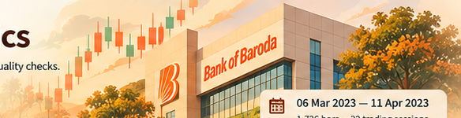
</p>

<p align="center">
  <strong>A beige-and-ivory Streamlit dashboard for exploring historical 5-minute OHLCV data.</strong><br>
  Price trends · Candlesticks · Volume · Returns & risk · Session analysis · Data quality
</p>

<p align="center">
  
  
  
  
  
</p>

> **Project scope:** Educational historical analytics using the included Bank of Baroda dataset. This project does not provide live market data, price forecasts, trading signals, buy/sell recommendations, or investment advice.

## 📌 Project overview

This project transforms five-minute Bank of Baroda (BANKBARODA) OHLCV observations into an interactive dashboard. The original Hackveda internship task focused on reading a Bank of Baroda CSV file and plotting a candlestick chart; this portfolio version extends that exercise with data validation, rolling averages, volume analysis, return and volatility summaries, session-level comparisons, filters, and CSV export.

The interface uses a consistent **beige-and-ivory theme**, warm chart panels, dark-brown headings, and a locally stored Bank of Baroda-themed banner. The charts are interactive: users can hover, zoom, pan, and inspect observations.

## 🎯 Project objective

Turn raw intraday market data into a clear analytical workflow for exploring:

- Price movements across five-minute intervals
- Open, High, Low, and Close (OHLC) behaviour
- Intraday and session-level trading volume
- Closing-price trends and rolling averages
- Five-minute returns and descriptive volatility
- Cumulative return behaviour for the selected series
- Session-level price ranges and returns
- Data-quality checks before visual analysis

**Workflow:** `Raw OHLCV data → Cleaning → Validation → Derived metrics → Analysis → Interactive visualization`

## 📊 Dataset

The bundled file `data/Bank_of_Baroda_5min_OHLCV.csv` contains **1,726 five-minute observations across 23 trading sessions**, from **6 March 2023 to 11 April 2023**.

| Dataset detail | Value |
|---|---:|
| Valid five-minute bars | 1,726 |
| Trading sessions | 23 |
| First observation | 6 Mar 2023, 09:15 IST |
| Last observation | 11 Apr 2023, 15:30 IST |
| Average five-minute volume | 326,026 shares (approx.) |
| Interval | 5 minutes |
| Instrument | Bank of Baroda |

The source is a limited historical sample, not a live feed or a long-term market-history dataset. Values and summary metrics shown by the app depend on the selected filters and the data supplied.

### Expected columns

| Column | Meaning |
|---|---|
| `Date` | Timestamp of the five-minute observation |
| `Open` | Opening price of the bar |
| `High` | Highest price during the bar |
| `Low` | Lowest price during the bar |
| `Close` | Closing price of the bar |
| `Volume` | Shares traded during the bar |

## 🧹 Data cleaning and validation

Before plotting, the application standardizes expected OHLCV fields, parses timestamps, converts numeric columns, removes incomplete required records and duplicate timestamps, sorts observations chronologically, and checks OHLC relationships and volume validity. Derived fields support the dashboard's moving averages, returns, and session summaries.

The supplied dataset displays **1,726 valid bars** and zero missing-required-value rows, duplicate timestamps, and invalid OHLC rows in the current quality view. Results may differ when a replacement CSV is uploaded.

## ✨ Dashboard features

- **Overview:** KPI cards for latest close, period return, period high and low, and average bar volume; closing-price chart and session summaries.
- **Interactive candlestick:** Five-minute Open, High, Low, and Close with Plotly hover, zoom, and pan. Green candles indicate `Close ≥ Open`; red candles indicate `Close < Open`.
- **Closing price and moving averages:** Close series with 20-bar and 50-bar rolling averages. These are bar-based windows, not calendar-day averages.
- **Intraday volume:** Five-minute volume bars and a session-level volume comparison.
- **Returns & risk:** Five-minute return distribution, return volatility, best/worst observed five-minute returns, median return, and cumulative return visualization.
- **Session analysis:** Session open/high/low/close, total volume, bar count, return, and summary comparisons including best/worst observed sessions.
- **Data quality:** Valid bars, missing required values, duplicate timestamps, invalid OHLC rows, a filtered-record table, and CSV download.
- **Analysis controls:** Optional CSV upload, trading-date range, intraday time window, and downloadable filtered records.

### Return calculations

Five-minute return is calculated from consecutive closing prices within each trading session:

```text
5-minute return (%) = ((Current Close / Previous Close) - 1) × 100
```

The first bar in a session has no previous intraday bar, so its return is not calculated from the prior session's close.

Session return is calculated from the session open and close:

```text
Session return (%) = ((Session Close / Session Open) - 1) × 100
```

Return volatility is the standard deviation of the observed five-minute return series for the selected period. The cumulative-return chart compounds the selected series for visualization; it is **not** a portfolio backtest and does not include transaction costs, taxes, or position sizing.

## 🖼️ Dashboard walkthrough

The screenshots below show the dashboard's appearance and main analysis views. They are stored locally in `assets/`, so GitHub can render them without external image-hosting links.

### 1. Dashboard overview

The landing view brings the date range, KPI cards, navigation, closing-price trend, and session summaries together in the warm beige-and-ivory interface.

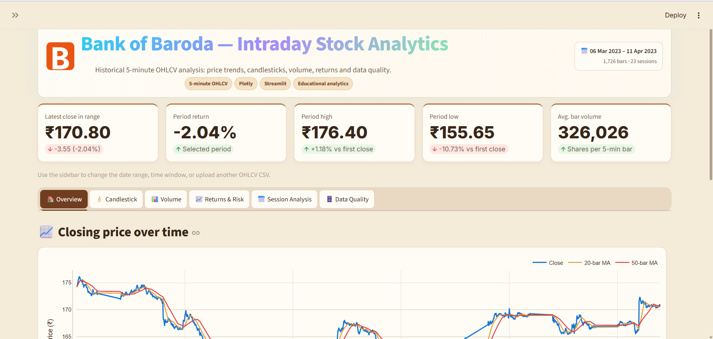

### 2. Sidebar and analysis controls

Upload a compatible OHLCV CSV, select the trading-date range, adjust the intraday time window, and review the dataset summary.

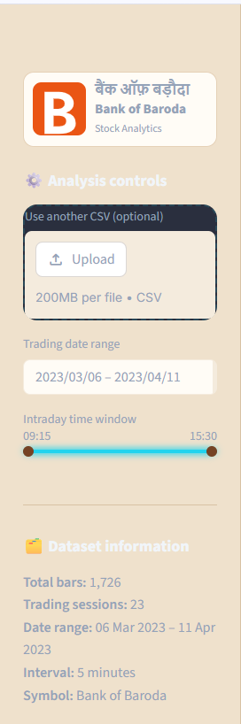

### 3. Closing price and moving averages

Compare historical closing prices with the 20-bar and 50-bar moving averages. These lines describe the selected data; they are not predictions.

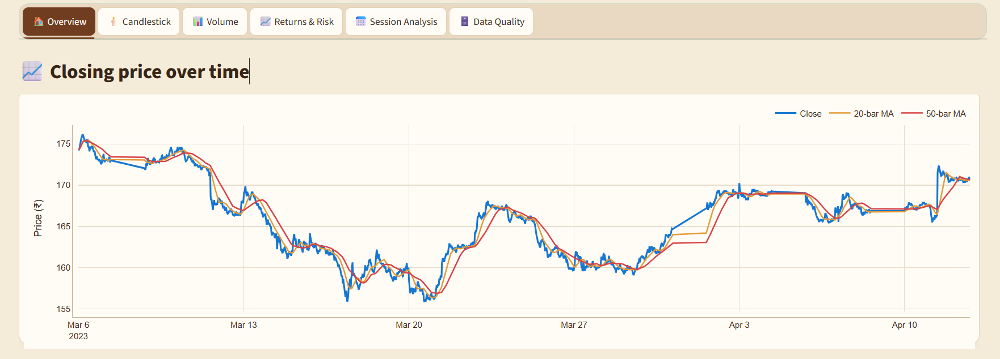

### 4. Interactive candlestick chart

Inspect five-minute OHLC values with Plotly hover details, zoom, and pan controls.

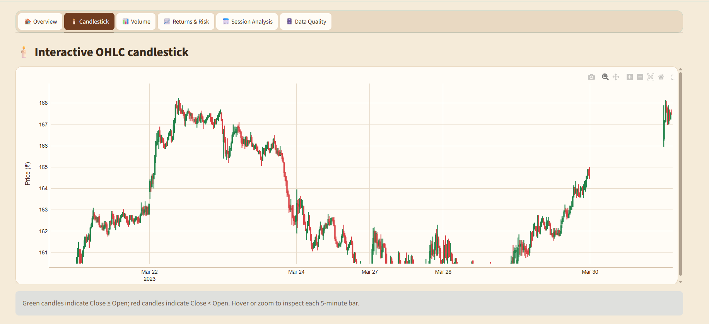

### 5. Candlestick detail

A closer view helps inspect individual intraday candles and their price ranges over selected dates.

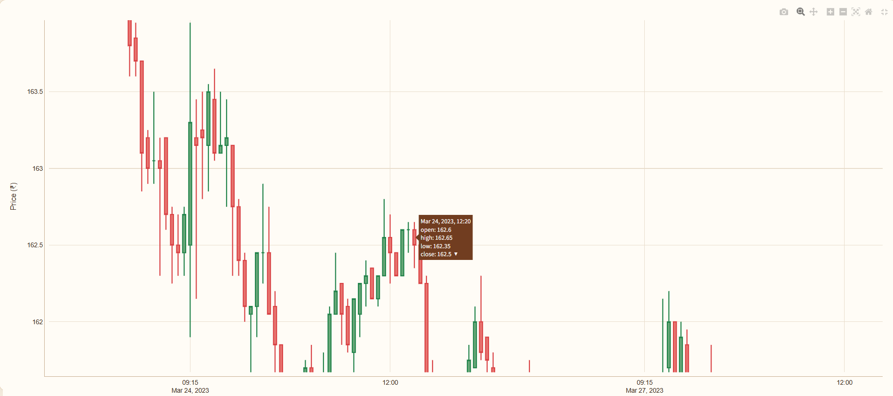

### 6. Intraday trading volume

View shares traded for each five-minute bar and identify periods of comparatively higher or lower recorded activity.

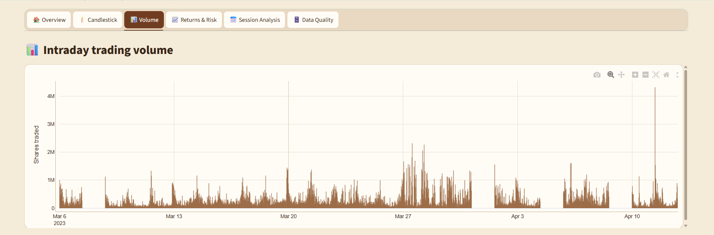

### 7. Five-minute volume detail

Inspect individual volume spikes in more detail across the available intraday observations.

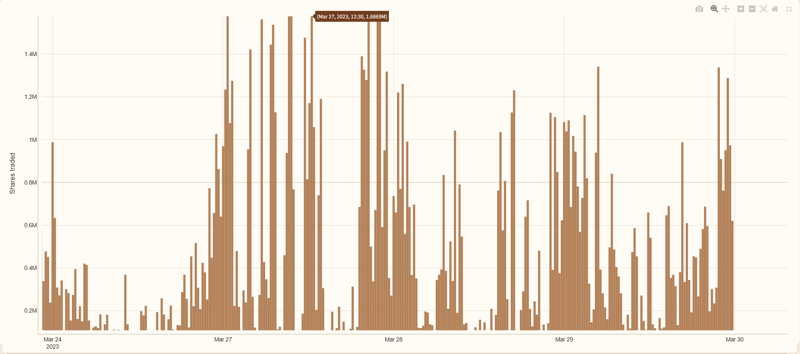

### 8. Session-level volume

Compare aggregate volume across trading sessions and identify dates with unusually high recorded activity.

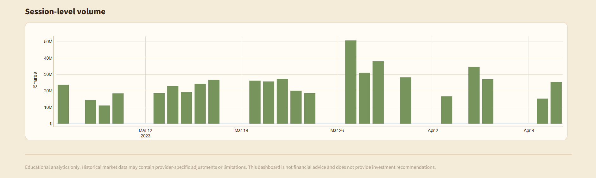

### 9. Price-trend detail

Explore how the close-price series and rolling averages change across the selected period and time window.

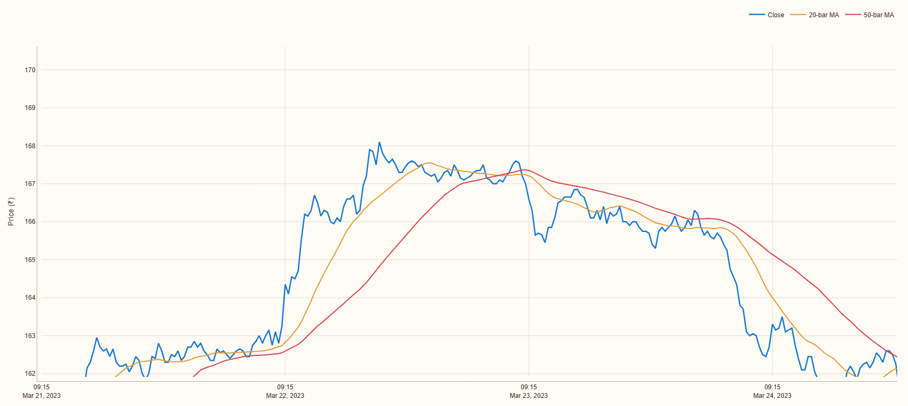

### 10. Cumulative intraday return

View the cumulative path derived from the selected return series. This is a descriptive historical visualization, not a simulated portfolio result.

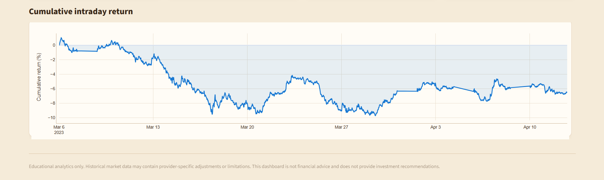

### 11. Returns and risk detail

Review return movements over time while considering the short interval and limitations of the historical sample.

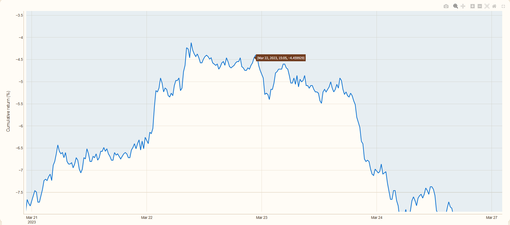

### 12. Five-minute return distribution

The histogram summarizes the distribution and spread of the observed five-minute returns.

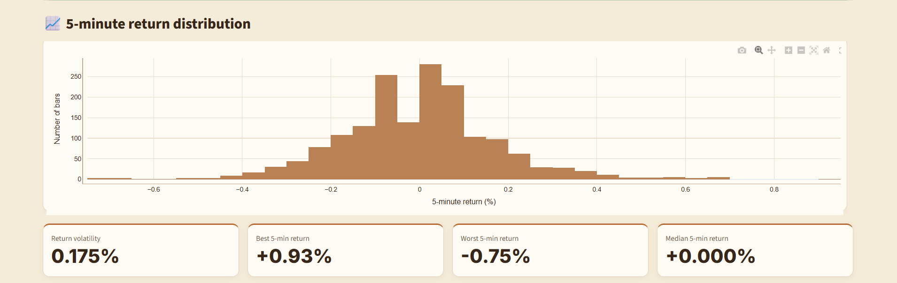

### 13. Session return comparison

Positive and negative bars make the observed session-level percentage returns easier to compare.

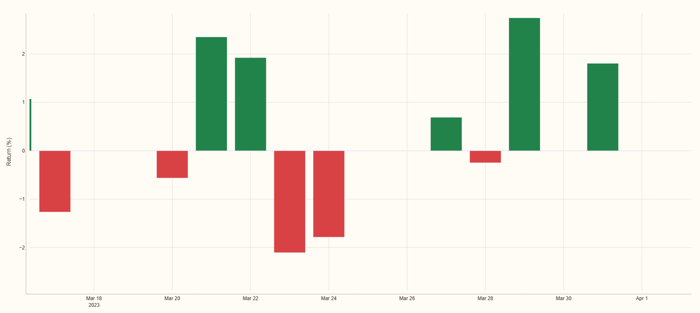

### 14. Session closing-price comparison

Compare the recorded closing price for each trading session in a compact bar chart.

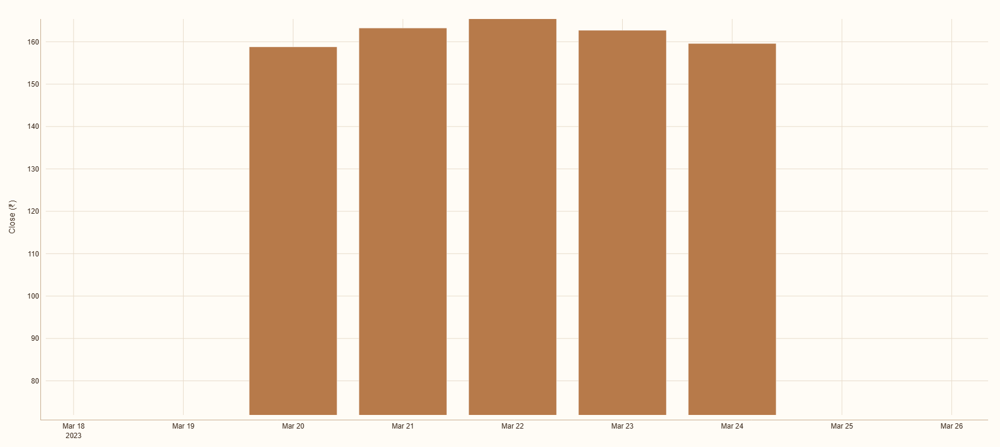

### 15. Session analysis charts

View session closing prices and session returns side by side for a quick comparison of price levels and percentage changes.

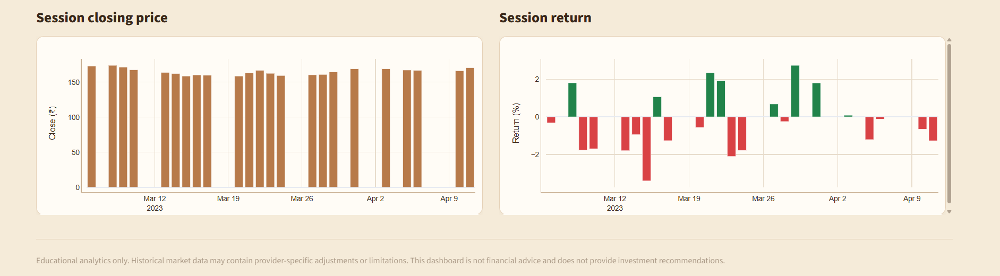

### 16. Trading-session summary

Review the best and worst observed sessions, highest intraday high, highest session volume, and session-level summary table.

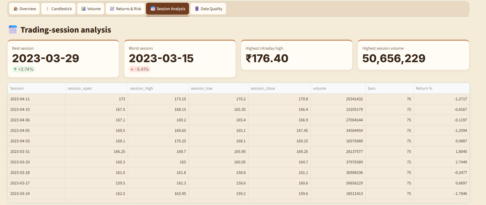

### 17. Data-quality checks

Review valid bars, missing required values, duplicate timestamps, invalid OHLC rows, and the available filtered records.

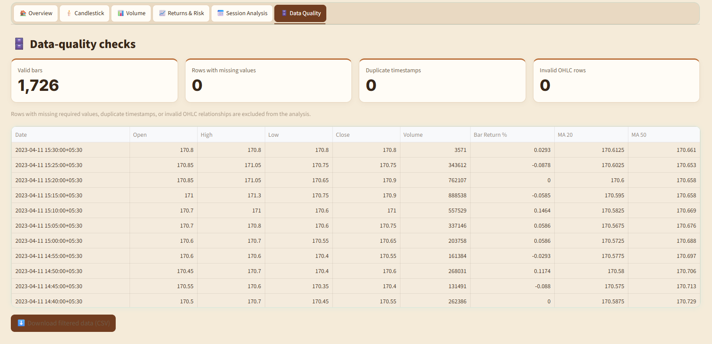

### 18. Volume-analysis overview

A final volume view complements the detailed five-minute and session-level volume charts.

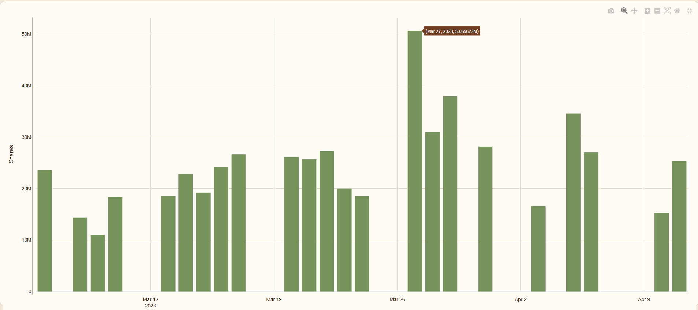

## 🛠️ Technology stack

| Technology | Purpose |
|---|---|
| Python | Application logic and analytical calculations |
| Pandas | Data loading, cleaning, transformation, and aggregation |
| NumPy | Numerical calculations |
| Plotly | Interactive candlestick and analytical charts |
| Streamlit | Interactive web dashboard |
| Jupyter Notebook | Reproducible analysis workflow (if included in the repository) |
| CSV | Historical OHLCV data storage |

## 🗂️ Project structure

```text
Bank-of-Baroda-Beige-Dashboard/
├── app.py
├── requirements.txt
├── README.md
├── .streamlit/
│   └── config.toml
├── data/
│   └── Bank_of_Baroda_5min_OHLCV.csv
└── assets/
    ├── bank_of_baroda_header.png
    ├── 01-dashboard-overview.png
    ├── 02-sidebar-controls.png
    ├── ...
    └── 18-volume-analysis-overview.png
```

## 🚀 Run locally on Windows

1. Download the project ZIP and extract it, or clone the repository.
2. Open Command Prompt in the project folder (the folder containing `app.py`).
3. Create and activate a virtual environment:

```cmd
python -m venv .venv
.venv\Scripts\activate
```

4. Install the dependencies:

```cmd
python -m pip install --upgrade pip
pip install -r requirements.txt
```

5. Start the dashboard:

```cmd
python -m streamlit run app.py
```

6. Open the local URL shown in the terminal, usually `http://localhost:8501`.

### macOS / Linux

```bash
python3 -m venv .venv
source .venv/bin/activate
python -m pip install --upgrade pip
pip install -r requirements.txt
python -m streamlit run app.py
```

## 📥 Upload and export data

A replacement CSV should contain a timestamp/date field and `Open`, `High`, `Low`, `Close`, and `Volume` columns. Use the sidebar upload control to load compatible data, then select the desired date and time filters. In **Data & Quality**, review the filtered rows and choose **Download filtered data (CSV)** to export the selected observations and calculated fields shown by the application.

Always verify the source, units, timestamp convention, and meaning of uploaded data before comparing results.

## ⚠️ Analytical limitations

- The bundled sample contains only 23 trading sessions and is not a long-term market study.
- The dashboard analyzes the supplied historical observations; it is not a live market feed.
- Five-minute returns and moving averages describe past observations and do not forecast future price direction.
- Volume shows recorded activity but does not, by itself, explain why a price moved.
- The project does not include company fundamentals, news, macroeconomic variables, transaction costs, taxes, or investor-specific circumstances.
- The cumulative-return chart is not a strategy backtest or an investable portfolio performance record.
- Results depend on the original data source and any replacement file uploaded.
- The screenshots illustrate dashboard views and do not imply that the data is current.

## 🔮 Possible future improvements

- Add RSI, MACD, Bollinger Bands, and VWAP as optional descriptive indicators.
- Compare the stock with a relevant benchmark such as NIFTY Bank.
- Analyze intraday seasonality by time of day.
- Explore volume-price relationships and annotate verified events/news.
- Add automated unit tests for data-processing functions.
- Add a separate educational strategy-backtesting module with clearly stated assumptions and costs.
- Add a data-refresh workflow or public deployment, subject to reliable data access and licensing.

## 🎓 Learning outcomes

This project demonstrates practical work with intraday financial-data preprocessing, OHLCV validation, time-series analysis, candlestick visualization, moving-average calculations, volume and return analysis, session aggregation, Plotly charts, Streamlit application development, CSV export, and portfolio project organization.

## 👨‍💻 Author

**Nadeem Ahamad**  
Data Analytics / Data Science project associated with **Hackveda Solutions Private Limited Internship**.

**Focus:** Intraday Stock Market Analysis · Time-Series Analytics · Financial Data Visualization · Python · Streamlit

## ⭐ Project note

If this project helps you learn financial-data analytics, Python visualization, or Streamlit dashboard development, consider giving the repository a ⭐ on GitHub.

---

**Disclaimer:** This project is for educational and portfolio purposes only. It presents descriptive analysis of historical Bank of Baroda market data and does not constitute financial, investment, trading, or tax advice.
